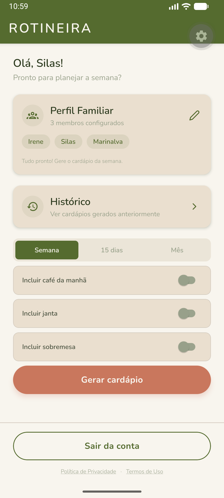
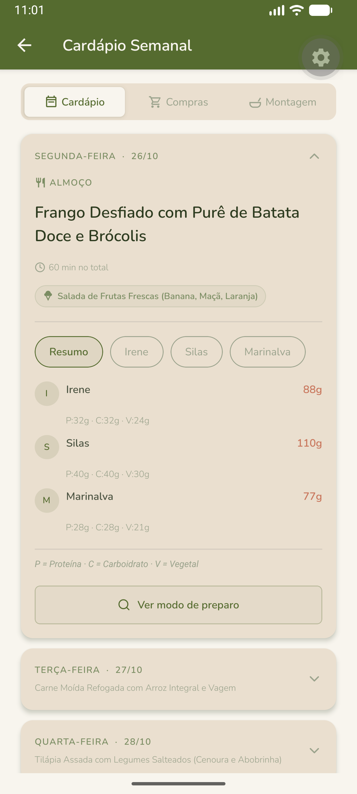
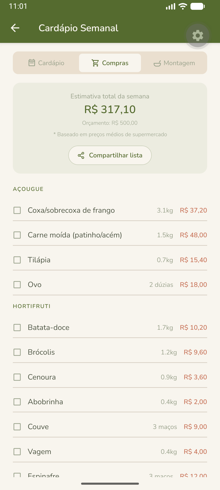
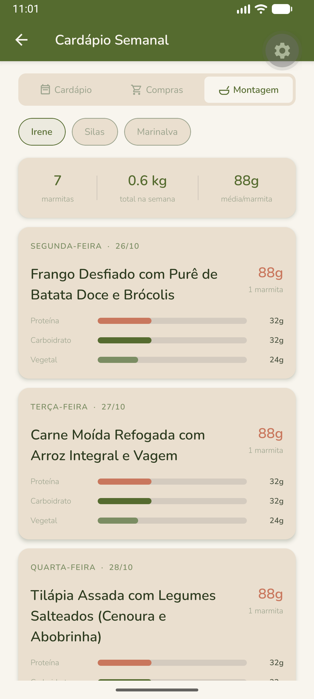

# Rotineira — Planejamento de Marmitas com IA

**App mobile que usa inteligência artificial para gerar cardápios semanais de marmitas, calcular a porção exata de cada pessoa da família e montar a lista de compras — sem a maratona mental de planejar o que cozinhar.**

## Sobre o projeto

Famílias com rotina corrida perdem horas toda semana decidindo o que cozinhar, calculando quantidade de ingredientes para pessoas diferentes e organizando compras — o que gera desperdício de comida, gasto desnecessário e estresse. O Rotineira resolve isso automatizando o processo inteiro: o usuário cadastra o perfil de cada membro da família (apetite, restrições alimentares, idade) e a IA gera um cardápio semanal completo, já com a gramagem de proteína/carboidrato/vegetal calculada por pessoa.

O projeto está em produção e em testes com usuários reais, com backend hospedado no Railway e banco no Supabase.

## Prévia

| | |
|---|---|
| **Login** <br>  | **Home** <br>  |
| **Cardápio semanal** <br>  | **Porções por membro** <br>  |
| **Lista de compras** <br>  | **Guia de montagem** <br>  |

## Funcionalidades

**Planejamento com IA**
- Geração de cardápio semanal, quinzenal ou mensal com IA (Gemini 2.5 Flash), focado em refeições congeláveis
- Cálculo automático de porções individuais por membro, com gramagem exata de proteína, carboidrato e vegetal
- Adaptação de cardápio existente por feedback em linguagem natural (texto ou voz)
- Orçamento semanal como restrição real: a IA ajusta o cardápio e, se necessário, reescala os preços para nunca estourar o valor definido

**Família**
- Cadastro de múltiplos membros com apetite (pouco/moderado/muito), restrições alimentares e limite calórico
- Cardápio individual por membro quando alguma restrição exige um prato alternativo

**Compras e montagem**
- Lista de compras consolidada da semana, organizada por categoria (Açougue, Hortifruti, Mercearia), com estimativa de preço
- Guia de montagem de marmitas com gramagem por membro, número de marmitas e instruções de preparo por refeição
- Exportação de cardápio e lista de compras como PDF

**Conta e monetização**
- Autenticação por e-mail/senha e Google OAuth (Supabase Auth)
- Histórico de cardápios gerados, com opção de reutilizar ou adaptar
- Plano Free (1 geração/semana, até 3 membros, só almoço) e Premium (ilimitado, até 10 membros, café da manhã/janta/sobremesa, períodos de 15 dias e mensal) via RevenueCat

## Arquitetura e stack

| Camada | Tecnologia |
|---|---|
| Frontend | React Native 0.86 + Expo SDK 57 (TypeScript), Expo Router, NativeWind, Zustand, React Query |
| Backend | FastAPI (Python 3.12), Pydantic v2 |
| IA | Google Gemini 2.5 Flash |
| Banco de dados | Supabase (PostgreSQL + Auth + Realtime) |
| Cache / fila | Redis (Upstash) |
| Infraestrutura | Railway (backend em Docker) + Supabase Cloud + Expo EAS Build |
| Monetização | RevenueCat |

O app conversa exclusivamente via REST com o backend FastAPI. Ao gerar um cardápio, o backend processa a chamada à IA de forma assíncrona (sem travar a API), valida o retorno estruturado com Pydantic, persiste no Postgres via Supabase e devolve o resultado para o app. Cardápios gerados ficam cacheados por alguns dias para evitar reprocessamento desnecessário.

Mais detalhes de arquitetura, agentes de IA e cronograma em [docs/](docs/).

## Estrutura do projeto

```
rotineira-app-meal-prep/
├── app/              # Telas (Expo Router) — (auth), (app), onboarding
├── src/
│   ├── components/   # Componentes de UI reutilizáveis
│   ├── lib/          # Cliente Supabase, API, helpers
│   ├── services/     # PDF, notificações, RevenueCat
│   ├── store/        # Estado global (Zustand)
│   ├── theme/        # Design system (cores, tipografia, spacing)
│   └── types/        # Tipos TypeScript compartilhados
├── backend/
│   └── app/
│       ├── agents/    # CardapioGeneratorAgent, ListaComprasAgent, GuiaMarmitasAgent, CardapioAdaptacaoAgent
│       ├── api/       # Rotas REST (v1)
│       ├── schemas/   # Modelos Pydantic
│       └── workers/   # Processamento assíncrono da geração de cardápio
├── supabase/          # Migrations do banco
├── docs/              # Documentação de arquitetura, stack e cronograma
└── assets/            # Ícones, imagens, fontes
```

## Como rodar localmente

**Pré-requisitos:** Node.js 20+, Python 3.12+, Docker, conta no Supabase e chave de API do Gemini.

```bash
git clone <url-do-repo>
cd rotineira-app-meal-prep

# Frontend
npm install
cp .env.example .env   # preencha EXPO_PUBLIC_SUPABASE_URL, EXPO_PUBLIC_SUPABASE_ANON_KEY, EXPO_PUBLIC_API_URL

# Backend
cd backend
cp .env.example .env   # preencha SUPABASE_URL, SUPABASE_SERVICE_KEY, REDIS_URL, GEMINI_API_KEY
docker compose up -d
```

| Serviço | Endereço |
|---|---|
| Metro (app) | `http://localhost:8081` |
| Backend (FastAPI) | `http://localhost:8000` |
| Supabase Studio | `http://localhost:54323` |
| Inbucket (e-mails locais) | `http://localhost:54324` |

```bash
npx supabase start   # só necessário ao mexer em migrations
npm start             # inicia o Metro / Expo
```

---

_Rotineira — equilíbrio para a rotina de quem cozinha para a família inteira._
